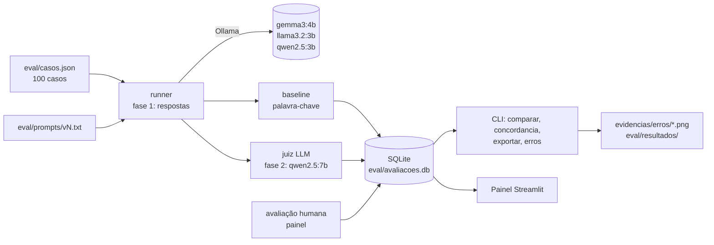

# Plataforma de avaliação de LLMs (Tema 3)

Uma "integração contínua para IA": roda baterias de casos de teste sobre modelos e versões de prompt, usa um **LLM como juiz** calibrado contra **notas humanas** e **acusa regressões** quando uma mudança piora o resultado. Tudo roda localmente com Ollama, a custo zero.

## Problema

Mudar um prompt ou trocar de modelo pode piorar as respostas sem que ninguém perceba. Avaliar à mão a cada mudança não escala, e usar um LLM para avaliar outro LLM só é confiável se soubermos **quanto o juiz concorda com pessoas** e **onde ele erra**.

## Arquitetura



| Módulo | Responsabilidade |
|---|---|
| [src/casos.py](src/casos.py) | Carrega e valida os casos e as versões de prompt |
| [src/model_runner.py](src/model_runner.py) | Chamada aos modelos via Ollama (temperatura 0, seed fixa) |
| [src/baseline.py](src/baseline.py) | Baseline: aprova se a resposta contém uma palavra-chave esperada |
| [src/judge.py](src/judge.py) | LLM juiz: veredito em JSON com justificativa |
| [src/runner.py](src/runner.py) | Bateria em duas fases (respostas, depois juiz) com logs datados |
| [src/evaluation.py](src/evaluation.py) | Taxa de acerto, kappa de Cohen, matriz de confusão, regressão |
| [src/results_store.py](src/results_store.py) | Persistência em SQLite |
| [src/erros.py](src/erros.py) | Gera imagens (prints) dos casos de falha em `evidencias/erros/` |
| [src/cli.py](src/cli.py) | Linha de comando |
| [src/app.py](src/app.py) | Painel: resultados por versão, regressão, avaliação humana, juiz × humano |

## Como rodar

### Com Docker (um comando)

```bash
docker compose up
```

Abra http://localhost:8501. Na primeira execução são baixados os modelos (~12 GB). Para rodar baterias dentro do container:

```bash
docker compose exec app python -m src.cli rodar --versao v1
```

### Local

Pré-requisitos: Python 3.11+ e [Ollama](https://ollama.com) com os modelos:

```bash
ollama pull gemma3:4b && ollama pull llama3.2:3b && ollama pull qwen2.5:3b && ollama pull qwen2.5:7b
pip install -r requirements-dev.txt
python -m streamlit run src/app.py
```

### Variáveis de ambiente (nenhuma chave necessária)

| Variável | Padrão | Uso |
|---|---|---|
| `MODELOS_AVALIADOS` | `gemma3:4b,llama3.2:3b,qwen2.5:3b` | Modelos comparados |
| `MODELO_JUIZ` | `qwen2.5:7b` | Modelo usado como juiz |
| `OLLAMA_HOST` | `http://localhost:11434` | Endereço do Ollama |
| `DATABASE_PATH` | `eval/avaliacoes.db` | Banco SQLite |

## Protocolo de avaliação

1. **Dados:** 100 perguntas de programação ([eval/casos.json](eval/casos.json), geradas por [eval/gerar_casos.py](eval/gerar_casos.py)) com resposta de referência e palavras-chave. Divisão fixa: **30 de calibração** (para ajustar o prompt do juiz) e **70 de teste** (nunca usados para ajuste).
2. **Baseline:** comparação por palavra-chave (sem acento, termo inteiro).
3. **Juiz:** `qwen2.5:7b`, um modelo maior que os avaliados, com prompt versionado (`juiz-v1`).
4. **Calibração:** pelo menos 30 respostas avaliadas por humanos do grupo **sem ver o veredito do juiz**. Mede-se o acordo percentual e o kappa de Cohen (juiz × humano e baseline × humano).
5. **Regressão:** o prompt `v2_piorado` é pior de propósito. `comparar` precisa acusar a queda (sai com código 1).
6. **Custo:** tempo e tokens por bateria, registrados em cada execução.

### Reproduzir os experimentos

```bash
python -m src.cli rodar --versao v1                 # 70 casos de teste x 3 modelos
python -m src.cli rodar --versao v2_piorado
python -m src.cli execucoes                         # lista execuções e taxas
python -m src.cli comparar <id_v1> <id_v2>          # acusa regressão
# avaliação humana no painel (aba "Avaliação humana")
python -m src.cli concordancia <ids...> --detalhes  # kappa e casos em que o juiz errou
python -m src.cli exportar <ids...>                 # CSV + metricas.json em eval/resultados/
python -m src.cli erros <ids...>                    # prints dos erros em evidencias/erros/
```

Use `--limite N` para uma rodada rápida e `--split calibracao` para ajustar o juiz.

## Testes e integração contínua

```bash
pytest --cov
ruff check .
```

Os testes usam um cliente Ollama falso, por isso rodam na CI sem modelos. O workflow fica em [.github/workflows/ci.yml](.github/workflows/ci.yml).

## Uso de IA na programação

Ferramentas usadas: _(preencher: por exemplo, Claude Code, GitHub Copilot)_. O registro das interações está em [PROMPTS.md](PROMPTS.md).

## Contribuição de cada integrante

| Integrante | Papel | Principais contribuições |
|---|---|---|
| _(nome)_ | Dados e Qualidade | |
| _(nome)_ | Backend e Infraestrutura | |
| _(nome)_ | IA e Avaliação | |
| _(nome)_ | Produto e Interface | |

## Licenças de terceiros

Ollama (MIT), Streamlit (Apache 2.0), pandas (BSD-3), Pillow (MIT-CMU), pytest (MIT), Ruff (MIT). Modelos: Gemma 3 (Gemma Terms of Use), Llama 3.2 (Llama 3.2 Community License), Qwen2.5-7B (Apache 2.0), Qwen2.5-3B (Qwen Research License). Conferir o cartão de cada modelo antes da entrega.
