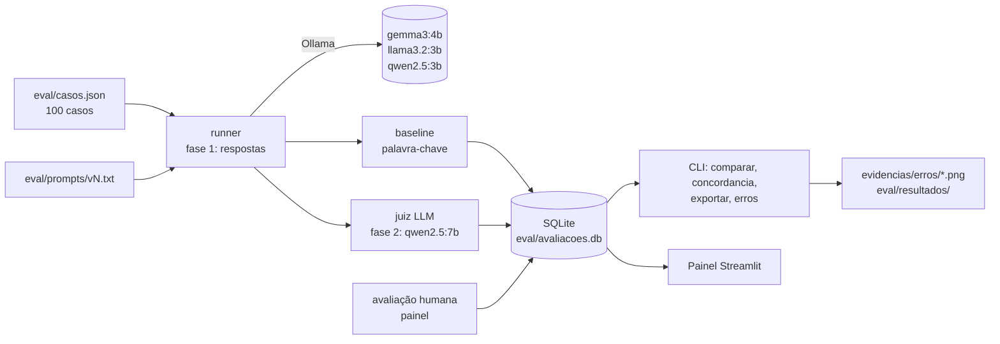
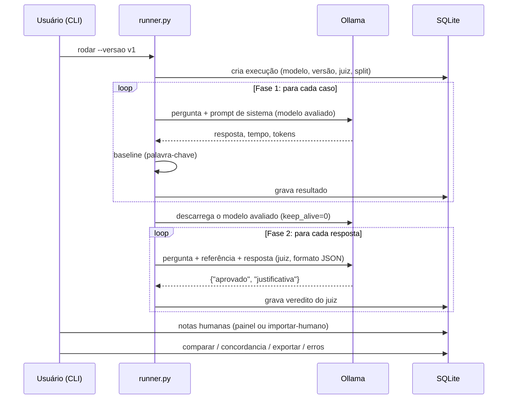
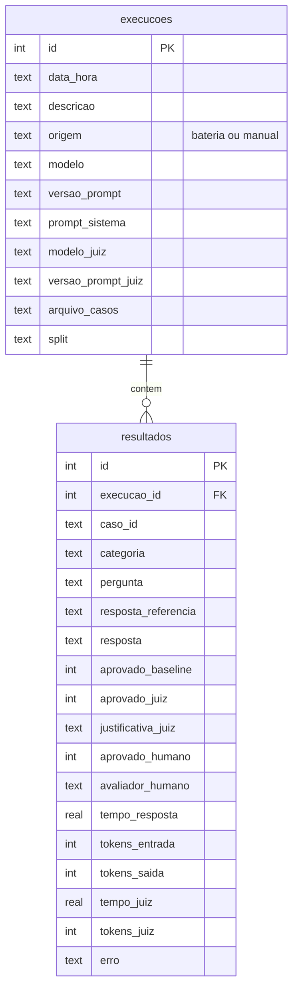

# 1. Visão geral e arquitetura

## Problema

Trocar o prompt de sistema ou o modelo de um assistente pode piorar as respostas sem que ninguém perceba. Avaliar à mão a cada mudança não escala. Usar um LLM para avaliar outro LLM resolve a escala, mas só é confiável se soubermos **quanto o juiz concorda com pessoas** e **em que casos ele erra**.

A plataforma responde a três perguntas:

1. Qual a taxa de acerto de cada modelo em cada versão de prompt?
2. O LLM juiz concorda com avaliadores humanos? (acordo percentual e kappa de Cohen)
3. Uma nova versão piorou o resultado em relação à anterior? (detecção de regressão)

## Diagrama de componentes

## Fluxo de dados de uma bateria

1. **Entrada:** os casos de teste ([eval/casos.json](../eval/casos.json)) e uma versão de prompt ([eval/prompts/](../eval/prompts/)).
2. **Fase 1 (respostas):** cada modelo avaliado responde a todos os casos com temperatura 0 e seed fixa. O baseline avalia cada resposta na hora.
3. **Fase 2 (juiz):** o modelo avaliado é descarregado da memória e o juiz avalia todas as respostas.
4. **Avaliação humana:** integrantes do grupo dão notas no painel sem ver os vereditos automáticos.
5. **Saída:** métricas, regressão e concordância na CLI e no painel; CSV, `metricas.json`, logs e imagens dos erros como evidência.

## Módulos

| Módulo | Responsabilidade |
|---|---|
| [src/casos.py](../src/casos.py) | Carrega e valida os casos e as versões de prompt |
| [src/model_runner.py](../src/model_runner.py) | Chamada aos modelos via Ollama (temperatura 0, seed 42), medição de tempo e tokens |
| [src/baseline.py](../src/baseline.py) | Aprova a resposta se ela contém uma palavra-chave esperada |
| [src/judge.py](../src/judge.py) | LLM juiz: prompt versionado e interpretação do veredito em JSON |
| [src/runner.py](../src/runner.py) | Bateria em duas fases, com logs datados |
| [src/evaluation.py](../src/evaluation.py) | Taxa de acerto, kappa de Cohen, matriz de confusão e regressão |
| [src/results_store.py](../src/results_store.py) | Persistência em SQLite, com migração de bancos antigos |
| [src/erros.py](../src/erros.py) | Classificação dos casos de falha e geração de imagens |
| [src/cli.py](../src/cli.py) | Linha de comando |
| [src/app.py](../src/app.py) | Painel Streamlit |

## Modelo de dados

O banco SQLite tem duas tabelas.

Cada execução guarda a versão e o texto do prompt, o modelo juiz e a versão do prompt do juiz. Assim, qualquer resultado pode ser rastreado até a configuração que o produziu. Ao iniciar, `initialize_database` cria as tabelas e acrescenta colunas que faltem em bancos de versões anteriores.
